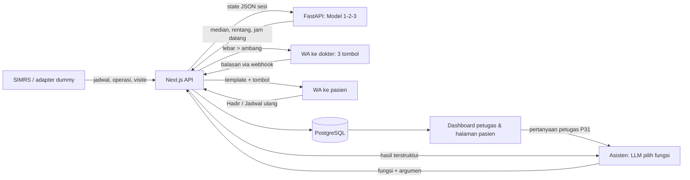

# 03 — ARCHITECTURE & Rencana Build

> Turunan dari 01-PRD. Prioritas: **Fase 0 (mockup statis untuk proposal) selesai sebelum 15 Okt 2026**, lalu alur inti berfungsi untuk demo day. ID task = ID di 04-TODO.

## 1. Stack
| Lapisan | Pilihan | Alasan |
|---|---|---|
| Web (Fase 0+) | **Next.js (App Router) + TypeScript strict**, versi stabil terbaru saat setup | Satu framework untuk halaman publik, dashboard, dan API route; bukan Laravel/Flutter [dari user] |
| Styling | **Tailwind CSS v4**, token dari `docs/08-DESIGN.md` (diekspor, bukan ditulis tangan) | Token tunggal, konsisten |
| Komponen UI | **shadcn/ui** (komponen dasar, variabel tema dipetakan ke token); sidebar: **animated sidebar 21st.dev (Aceternity)** diadaptasi | Urutan sumber komponen di 07-RULES §8; jangan pakai sidebar shadcn |
| Ikon | **lucide-react**, stroke 1.75 | Satu library, tanpa emoji |
| Visualisasi data | **Recharts** lewat komponen `chart` shadcn | Hanya di P15 Laporan |
| Font | **Plus Jakarta Sans** lewat `next/font/google` (self-host otomatis) | Dibuat oleh desainer Indonesia, angka tabular untuk jam |
| Data Fase 0 | **File statis** `docs/seed/mockup-data.json` disalin ke `web/src/data/` | Mockup tanpa backend |
| Layanan model (Fase 1+) | **Python 3.12 + FastAPI**, numpy, scikit-learn | Kode `docs/riset/lampiran-c/simulasi_kapandok.py` dipakai ulang |
| Database (Fase 1+) | **PostgreSQL** + **Drizzle ORM** (di Next.js) | Relasional, ringan |
| Auth (Fase 1+) | **Auth.js** credentials (email + password, hash bcrypt/argon2) | Akun dibuat admin [asumsi] |
| LLM asisten (Fase 1+, hanya P31) | **Claude Sonnet 5.5** (`claude-sonnet-5-5`) lewat Anthropic API dengan tool use + structured output; versi dikunci [asumsi] | Andal memilih fungsi dan argumen; tanpa LLM di jalur prediksi. Produksi di RS: pilih ulang setelah cek UU PDP (transfer data lintas negara) dan perjanjian pengolahan data; cadangan model open-weight di server RS |
| Pesan | **WhatsApp Cloud API (Meta)**, nomor uji untuk demo | Kanal yang sudah dipakai mitra [riset: balasan mitra] |
| Integrasi SIMRS | **Adapter sistem-agnostik** (REST + bentuk data mengikuti HL7 FHIR `Appointment`, `Schedule`, `Slot`, `Practitioner`) | Saran mitra; vendor SIMRS konfidensial |
| Hosting | Vercel (web) + Railway/Render atau lokal (FastAPI + Postgres) [asumsi] | Gratis/murah untuk demo |
| Package manager | **pnpm** (web), **uv** atau pip (ml) | — |

## 2. Perintah Verifikasi & Setup
| Cek | Perintah |
|---|---|
| Install | `cd web && pnpm install` · `cd ml && uv sync` (Fase 1+) |
| Dev | `cd web && pnpm dev` · `cd ml && uv run fastapi dev app/main.py` (Fase 1+) |
| Migrasi / seed | `cd web && pnpm db:migrate && pnpm db:seed` (Fase 1+) |
| Test | `cd web && pnpm test` (Vitest) · `cd ml && uv run pytest` |
| Build | `cd web && pnpm build` |
| Typecheck | `cd web && pnpm typecheck` (`tsc --noEmit`) |
| Lint | `cd web && pnpm lint` · `cd ml && uv run ruff check .` |
| Dead code | `cd web && pnpm dlx knip` · `cd ml && uv run vulture app` |
| Token desain | `npx -p @google/design.md designmd lint docs/08-DESIGN.md` lalu `npx -p @google/design.md designmd export --format css-tailwind docs/08-DESIGN.md > web/src/styles/theme.css` |
| Screenshot mockup (Fase 0) | `cd web && pnpm shots` (Playwright: 1440×900 untuk desktop, 390×844 untuk mobile → `docs/mockup/*.png`) |
| Eval model (Fase 1+) | `cd ml && uv run python eval/run.py` → cakupan interval 90% dan MAE |
| Alur inti | Fase 0: buka 5 layar di browser, cocokkan dengan skenario. Fase 1+: mode demo P22 end-to-end, WA masuk ke nomor uji |

## 3. Model Data (Fase 1+)
| Entitas | Field kunci | Relasi | Sumber |
|---|---|---|---|
| Poli | id, nama | 1-n Dokter | admin |
| Dokter | id, nama, gelar, poli_id, no_wa, aktif | n-1 Poli | admin |
| JadwalPraktik | id, dokter_id, hari, jam_mulai, jam_selesai, kuota | n-1 Dokter | admin / SIMRS |
| SesiPraktik | id, jadwal_id, tanggal, jam_mulai_resmi, status (`terjadwal`/`berjalan`/`terlambat`/`batal`/`selesai`), jam_mulai_aktual | n-1 JadwalPraktik | dibuat harian |
| Prediksi | id, sesi_id, dibuat_pada, median, batas_bawah, batas_atas, alasan, sumber (`model`/`dokter`/`petugas`) | n-1 Sesi | layanan model |
| Sinyal | id, sesi_id, jenis (`operasi`/`visite`/`riwayat`/`konfirmasi`), nilai_json, waktu | n-1 Sesi | adapter SIMRS / WA |
| Pasien | id, nama, no_wa (terenkripsi), | 1-n Kunjungan | SIMRS |
| Kunjungan | id, sesi_id, pasien_id, kode_booking, no_antrean, jenis (`kontrol`/`baru`), slot_awal, jam_datang, perkiraan_dipanggil, saran_berangkat, status (`terjadwal`/`hadir`/`jadwal_ulang`/`dilayani`/`tidak_datang`) | n-1 Sesi, n-1 Pasien | SIMRS + optimizer |
| Pesan | id, kunjungan_id atau dokter_id, template, variabel_json, wa_message_id, status (`antre`/`terkirim`/`dibaca`/`dibalas`/`gagal`), balasan, waktu | n-1 Kunjungan/Dokter | sistem + webhook WA |
| TindakLanjut | id, kunjungan_id, alasan (`jadwal_ulang`/`belum_dibaca`/`gagal_kirim`), status, ditangani_oleh | n-1 Kunjungan | otomatis |
| Pengguna | id, nama, email, hash_password, peran (`petugas`/`admin`), aktif | — | admin |
| UsulanAksi | id, pengguna_id, jenis (`jadwal_ulang`/`kirim_ulang`), target_ids, perubahan_json (sebelum → sesudah), versi_data, status (`menunggu`/`dijalankan`/`dibatalkan`/`kedaluwarsa`), dibuat_pada, dijalankan_pada | n-1 Pengguna | fungsi asisten |
| LogAktivitas | id, pengguna_id, sumber (`menu`/`asisten`), aksi, objek, sebelum_json, sesudah_json, waktu | n-1 Pengguna | otomatis |
| Pengaturan | ambang_lebar_rentang, ambang_ubah_jam, menit_tunggu_pilih_slot, bobot_menganggur, jam_kirim_awal, template_ids | — | admin |

Fase 0 memakai bentuk yang sama secara statis di `docs/seed/mockup-data.json` (subset: sesi + antrean dr. Rina).

## 4. Integrasi & Alur Sistem
- **Integrasi pihak ketiga:**
  - WhatsApp Cloud API: kirim template + tombol quick reply (maks 3 per pesan), webhook status (`sent`/`delivered`/`read`) dan balasan tombol. Batas nomor penerima di nomor uji: cek dokumentasi Meta terbaru [asumsi].
  - SIMRS mitra: adapter REST; Fase 1-2 memakai **adapter dummy** yang membaca data simulasi.
- **Alur sistem:**

- **Keamanan & privasi dasar:**
  - Validasi semua input di batas kepercayaan (form, webhook WA dengan verifikasi signature, API adapter).
  - Otorisasi per peran; `/admin/*` hanya admin; halaman `/k/[kode]` hanya menampilkan data kunjungan pemilik kode (kode acak, tidak berurutan, kedaluwarsa setelah hari praktik).
  - Secret di `.env` (tidak di-commit): `DATABASE_URL`, `WA_TOKEN`, `WA_PHONE_ID`, `WA_APP_SECRET`, `AUTH_SECRET`.
  - Asisten (P31): LLM memakai hak akses akun yang login (tidak punya hak sendiri); hasil fungsi yang dikirim ke LLM berisi ID + ringkasan, sedangkan tabel nama pasien dirender langsung oleh web; nomor WA dan NIK tidak pernah dikirim ke LLM; balasan teks bebas pasien diperlakukan sebagai data, bukan perintah; setiap aksi tercatat di LogAktivitas dengan sumber `asisten`. Secret tambahan: `ANTHROPIC_API_KEY`.
  - Data pribadi minimal; nomor WA dienkripsi; halaman publik tidak pernah menampilkan nama pasien lain; alasan medis dokter tidak dibuka ke pasien. Patuh UU PDP (UU 27/2022).

## 5. Peta Panggilan Model
> Model dipanggil oleh kode sebagai fungsi kecil dengan state JSON; kode yang memutuskan. LLM hanya dipakai di P31 Asisten petugas (tabel kedua); polanya di `docs/AI-PRIMITIVES.md`.

| Titik keputusan | Panggilan | Input (JSON) | Output | Ambang | Eskalasi |
|---|---|---|---|---|---|
| Jam mulai sesi | `POST /predict/start` | `{sesi_id, jam_resmi, penyebab, beban_tersisa_menit, kebiasaan_telat}` | `{median, lo90, hi90, alasan}` | lebar `hi90-lo90` > 30 mnt → minta dokter | WA dokter → bila 15 mnt tanpa balasan → petugas (P11) |
| Jam datang antrean | `POST /optimize/arrivals` | `{mulai: {median, residual_sampel}, pasien:[{no, jenis, slot_awal}], bobot_menganggur}` | `[{no, jam_datang, perkiraan_dipanggil}]` | kirim bila berubah ≥ 10 mnt | — |
| Durasi & no-show | di dalam optimizer | `{jenis, riwayat_no_show}` | `{mean_durasi, p_no_show}` | — | — |

- **Kapan dihitung:** setiap sinyal baru atau tiap 5 menit sejak T-120 sampai sesi mulai.
- **Ambang disimpan di:** tabel `Pengaturan`, bukan di kode.
- **Versi dikunci:** `model_versi` disimpan di setiap baris Prediksi.
- **Eval:** 1.000 hari uji sintetis; target cakupan interval 85-95%, MAE ≤ 15-16 mnt (baseline simulasi: 93,4% dan 16,0 mnt).
- **Biaya & latensi:** CPU saja; target < 500 ms per sesi (300 skenario SAA).

**Asisten petugas (P31).** LLM hanya memilih fungsi; semua fungsi di bawah adalah kode biasa dengan cek hak akses.

| Fungsi | Jenis | Input (JSON) | Output | Konfirmasi |
|---|---|---|---|---|
| `rekap_antrean` | baca | `{sesi_id \| dokter, status?}` | `{baris:[{kunjungan_id, antrean, jam_datang, status_pesan}], ringkasan}` → web merender tabel | langsung |
| `cari_pasien` | baca | `{teks}` | `[{kunjungan_id, nama, sesi_id}]` (maks 5) | langsung; > 1 hasil → asisten bertanya balik |
| `ringkas_sesi` | baca | `{sesi_id}` | prediksi, rentang, konfirmasi dokter, ringkasan pesan | langsung |
| `analisis_jadwal_ulang` | analisis | `{kunjungan_id}` | `{slot:[3], efek_antrean, penanda:[{jenis, nilai, sumber}]}` | langsung (tidak mengubah data) |
| `usulkan_jadwal_ulang` | usulan | `{kunjungan_id, slot_id}` | `{usulan_id, perubahan, kedaluwarsa}` → kartu usulan | — |
| `usulkan_kirim_ulang` | usulan | `{kunjungan_ids}` (maks 5) | `{usulan_id, penerima}` | — |
| `jalankan_usulan` | tulis | `{usulan_id, pesan_konfirmasi_id}` | struk: perubahan, jam kirim WA (tertahan 5 mnt), log_id | wajib: pesan petugas sesudah usulan; versi data sama; belum kedaluwarsa |
| `batalkan_aksi` | tulis | `{log_id}` | status | selama WA masih tertahan |

- **Ambang & batas** (di `Pengaturan`): masa berlaku usulan 10 mnt, jeda batal WA 5 mnt, maks 5 penerima per kirim ulang. Batal praktik dan ubah jam mulai **tidak** tersedia lewat asisten (arahkan ke M2/M3).
- **Konteks per percakapan:** state JSON kecil (pengguna, peran, tanggal, sesi aktif, usulan menunggu), bukan seluruh database.
- **Eval:** 40 percakapan berlabel (fungsi + argumen benar ≥ 95%) + 10 uji prompt injection (termasuk balasan WA berisi perintah) dengan target **0 aksi tanpa konfirmasi**; penilai deterministik (bandingkan panggilan fungsi), bukan LLM-as-judge.
- **Versi dikunci:** id model + versi prompt disimpan di setiap baris LogAktivitas bersumber `asisten`.
- **Biaya & latensi:** 2-4 panggilan LLM per permintaan; target < 4 detik sampai tabel tampil [asumsi, ukur saat T33].

## 6. Rencana Build
Task ≤ ½ hari, punya kriteria selesai. Pemilik diisi tim.
**Urutan setelah Fase 0 mengikuti 01-PRD §5f:** semua task gelombang 1 (demo day: T11-T20, T22, T23, T30 dan P20 dari T21) selesai sebelum task gelombang 2 (sisa T21, T24, T31, T26-T29).

| ID | Milestone | Task | Pemilik | Fitur | Kriteria selesai |
|---|---|---|---|---|---|
| T1 | **Fase 0: Mockup** | Scaffold `web/` (Next.js + TS strict + Tailwind v4 + shadcn init + lucide), ekspor token dari 08-DESIGN, font Plus Jakarta Sans | — | F0 | `pnpm build`, `typecheck`, `lint` hijau; halaman kosong memakai token |
| T2 | Fase 0 | Salin `docs/seed/mockup-data.json` ke `web/src/data/`, tulis tipe TS dan helper format jam | — | F0 | Tipe lengkap, tanpa `any` |
| T3 | Fase 0 | Shell aplikasi petugas: sidebar 21st.dev teradaptasi + kartu akun + label "Data simulasi"; header publik untuk halaman pasien | — | F0 | Sidebar sesuai 01-PRD §5b, drawer mobile sesuai 08-DESIGN |
| T4 | Fase 0 | **P10 Hari ini** (5 sesi; urut: butuh perhatian di atas) | — | F0 | Sesuai skenario; responsif 1440/768/375 |
| T5 | Fase 0 | **P11 Detail sesi dr. Rina** (22 pasien, status pesan) | — | F0 | Angka sama dengan `ringkasan_pesan_rina` |
| T6 | Fase 0 | **P1 Cek jadwal (mobile)** | — | F0 | 5 dokter, dr. Agus tampil "Batal" |
| T7 | Fase 0 | **P4 Jam datang saya `KD-4812` (mobile)** | — | F0 | Saran berangkat 10.45, dipanggil 11.30, antrean 12 |
| T8 | Fase 0 | **P15 Laporan dampak** memakai angka simulasi berlabel | — | F0 | Angka sama dengan `docs/riset/lampiran-c/ringkasan.md` |
| T9 | Fase 0 | Script `pnpm shots` (Playwright) + ekspor PNG ke `docs/mockup/` | — | F0 | 5 PNG tajam (deviceScaleFactor 2) |
| T10 | Fase 0 | Review konsistensi & checklist UI 07-RULES §8 | — | F0 | Laporan sesuai 07-RULES §10 |
| T11 | Fase 1: Fondasi data | Postgres + Drizzle schema §3 + seed dari mockup-data | — | — | migrasi + seed jalan |
| T12 | Fase 1 | Auth.js credentials, peran, guard `/admin/*` (P7, P25) | — | F8 | Petugas ditolak di `/admin` (test) |
| T13 | Fase 1 | `ml/` FastAPI: port Model 1 dari simulasi + `/predict/start` + eval | — | F1 | Eval cakupan 85-95% (test) |
| T14 | Fase 1 | `/optimize/arrivals` (Model 2-3) | — | F3 | Jam datang ≥ slot awal (test) |
| T15 | Fase 1 | WA Cloud API: kirim template + webhook status & tombol | — | F2, F4 | Pesan masuk ke nomor uji; status tercatat |
| T16 | Fase 1 | P10 & P11 memakai data DB + pembaruan berkala | — | F5 | Alur inti 1-5 jalan dengan adapter dummy |
| T17 | Fase 1 | P12 Tindak lanjut otomatis | — | F6 | Jadwal ulang tanpa pilihan 30 mnt muncul |
| T18 | Fase 1 | P1, P3, P4 dari DB + kode booking acak | — | F7 | Kode salah ditangani |
| T19 | Fase 2: Lengkap | P5 slot pengganti | — | F9 | Slot terambil hilang |
| T20 | Fase 2 | P15 Laporan dari data | — | F10 | Angka cocok dengan query |
| T21 | Fase 2 | P16-P20, P29, P30 admin (dokter + detail, poli, jadwal, pengguna, pengaturan) + modal M4, M5 | — | F11 | CRUD + validasi |
| T22 | Fase 2 | P22 Mode demo (30× lebih cepat, WA asli) | — | F12 | Satu sesi end-to-end < 3 menit |
| T23 | Fase 2 | Adapter SIMRS dummy + kontrak FHIR terdokumentasi | — | F13 | Ganti adapter tanpa ubah kode inti |
| T24 | Fase 2 | P6 privasi, P26 bantuan pasien, P23 404, P24 500 | — | — | Halaman tersedia |
| T30 | Fase 1 | Modal M1-M3 di P11 (konfirmasi atas nama dokter, ubah jam mulai, batalkan praktik) | — | F5 | Pratinjau jumlah pasien terdampak sebelum simpan |
| T31 | Fase 2 | P28 Riwayat sesi + P27 Log aktivitas | — | — | Koreksi manual tercatat di log |
| T32 | Fase 0 | **P31 Asisten petugas (mockup statis)**: percakapan rekap → analisis jadwal ulang Ibu Nur Hidayah → struk aksi | — | F17 | Tabel dihitung dari seed (10 pasien belum konfirmasi hadir); responsif 1440/768/375; label "Data simulasi" |
| T33 | Fase 1 | Fungsi asisten baca + analisis (`rekap_antrean`, `cari_pasien`, `ringkas_sesi`, `analisis_jadwal_ulang`) + cek hak akses | — | F17 | Test: petugas tidak bisa memanggil fungsi admin; analisis memakai Model 3 |
| T34 | Fase 1 | Usulan + `jalankan_usulan` + jeda batal WA + LogAktivitas | — | F17 | Test: tanpa konfirmasi → ditolak; data berubah → ditolak; batal dalam 5 mnt → WA tidak terkirim |
| T35 | Fase 1 | Integrasi LLM (tool use) + UI P31 live + eval 40 + 10 | — | F17 | Fungsi benar ≥ 95%; 0 aksi tanpa konfirmasi |
| T25 | Fase 3: Hackathon | Sambungkan data/izin mitra (bila ada), latih ulang Model 1, latihan demo (05-PITCH) | — | — | Demo lulus 2× tanpa error |
| T26 | Could | F14 riwayat pesan, F15 pengingat H-1, F16 teks besar | — | F14-16 | — |

## 7. Risiko & Cadangan
| Risiko | Cadangan |
|---|---|
| Fase 0 molor (deadline 15 Okt) | Batasi 5 layar statis; P15 boleh dipotong dulu, P10/P11/P4 wajib |
| Sinyal SIMRS tidak tersedia | Riwayat jam mulai + konfirmasi dokter; adapter dummy |
| Nomor uji/verifikasi WhatsApp tertunda | Simulator chat di web (pakai `docs/riset/lampiran-c/mockup_wa.html` sebagai acuan tampilan) |
| Model tidak akurat pada data asli | Interval lebar → minta dokter; tampilkan rentang, bukan janji pasti |
| Internet demo day bermasalah | Video rekaman demo + mode demo lokal |
| LLM salah memilih fungsi atau mengarang jawaban | Tabel/struk dari hasil fungsi; "sudah" hanya dari struk; eval sebelum demo; asisten mati → menu biasa tetap lengkap |
| Prompt injection lewat balasan WA | Balasan bebas tidak dikirim ke LLM; fungsi tulis butuh konfirmasi petugas |
| Kekhawatiran privasi data pasien ke API luar | Demo hanya data simulasi; produksi menunggu keputusan mitra (API dengan perjanjian data atau model di server RS) |

## 8. Q&A Keputusan
| # | Pertanyaan | Keputusan | Tanggal |
|---|---|---|---|
| Q1 | Dokter memakai web atau WA? | WA (3 tombol); tidak ada halaman dokter | 2026-10-12 |
| Q2 | Data apa yang dipakai? | Data simulasi berlabel; data asli setelah izin mitra | 2026-10-12 |
| Q3 | Pakai LLM? | Jalur prediksi tetap tanpa LLM. LLM hanya untuk P31 Asisten petugas sebagai lapisan percakapan; kode yang menghitung dan memutuskan (diperbarui atas permintaan pengguna) | 2026-10-12 |
| Q7 | Asisten boleh menjalankan aksi? | Ya, untuk aksi kecil (jadwal ulang 1 pasien, kirim ulang ≤ 5) setelah petugas mengonfirmasi di chat; aksi besar tetap lewat modal M2/M3; tidak pernah menilai kondisi medis | 2026-10-12 |
| Q4 | Kebutuhan sekarang? | Hanya mockup statis 5 layar untuk proposal (Fase 0) | 2026-10-12 |
| Q5 | Jadwal ulang | Otomatis tawarkan 3 slot, lalu ke petugas bila 30 mnt tanpa pilihan | 2026-10-12 |
| Q6 | Integrasi SIMRS | Adapter sistem-agnostik, bentuk data mengikuti FHIR | 2026-10-12 |
